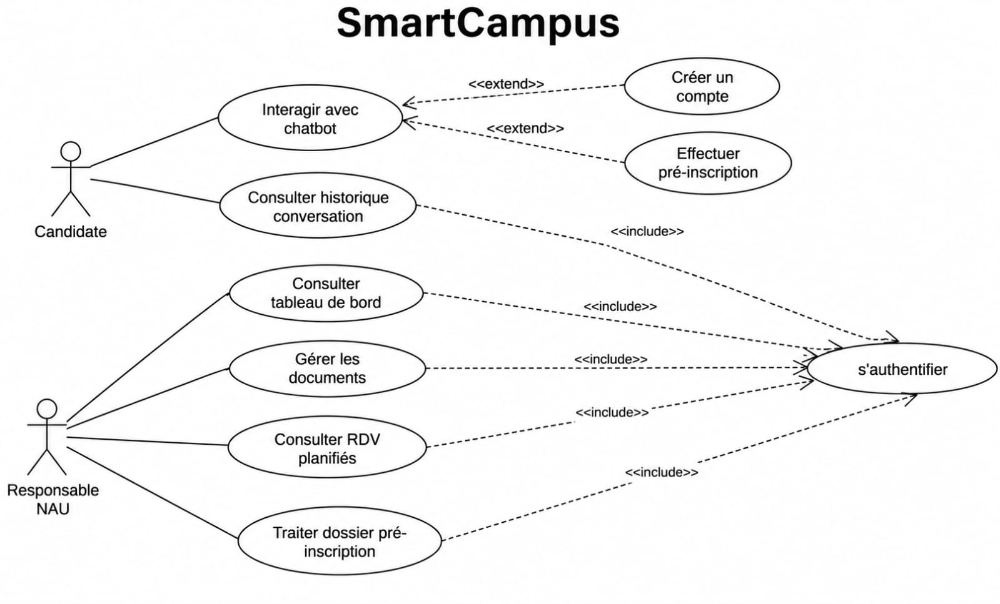

# SmartCampus AI – Architecture

## 1. Use Case Diagram

## 2. Architecture technique

## 2. Technological Stack

| Component | Technology |
|---|---|
| Frontend | React + TypeScript + Vite |
| Backend principal | NestJS |
| Service IA | Python + FastAPI |
| Orchestration agentique | LangGraph |
| Base métier | PostgreSQL |
| Base vectorielle | pgvector |
| Extraction PDF | PyMuPDF |
| Extraction DOCX | python-docx |
| Embeddings | Sentence Transformers ou modèle d'embedding adapté |
| Communication | HTTP/REST |
| Déploiement | Docker Compose |